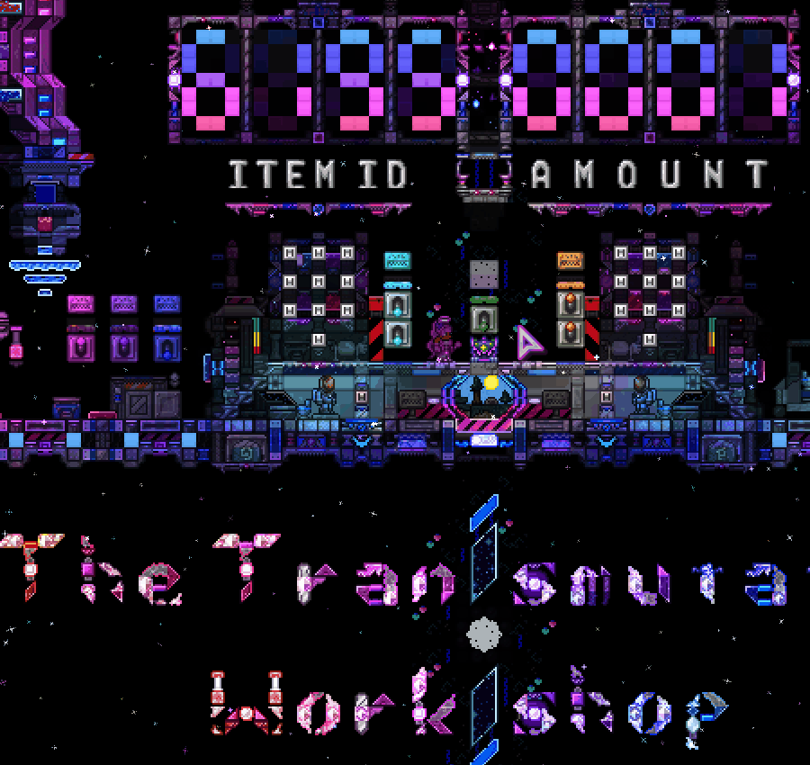

# Terraria Transmutation Workshop ROM Updater

<p align="center">
  
</p>

A simple Terraria utility for dynamically recalculating and updating the **Transmutation Workshop's item-max ROM** using the game's current maximum vanilla Item ID.

The Transmutation Workshop uses a compact **20-bit XOR encoded ROM value** to determine the maximum valid item ID. When Terraria adds new items, this value must be updated. This tool automates that process using the in-game command `/tw itemmax`.

> **Current Version:** This implementation modifies Terraria's `ChatCommandProcessor` directly. A tModLoader version can be made later using the same ROM conversion logic.

## How It Works?

The item-max ROM is a single 20-bit horizontal row located at:

```text
(453,301) -> (472,301)
```

The ROM contains:

```text
4-bit operation | 16-bit item threshold
```

The source operation remains:

```text
0010
```

The updater automatically gets Terraria's current maximum vanilla Item ID using:

```csharp
int maxItemID = (int)ItemID.Count - 1;
```

It then performs the same conversion used by the Transmutation Workshop:

1. Build the 20-bit source value.
2. Shift the source left by one bit.
3. XOR the source with the shifted value.
4. Keep the 4-bit XOR operation.
5. Reverse the 16-bit threshold portion.
6. Reassemble the physical ROM pattern.
7. Rewrite all 20 wire states in the ROM.

Because every ROM bit is explicitly set on each update, running the command again **replaces the previous pattern** rather than overlapping it.

### Example: 6144

```text
source      0010 | 0001 1000 0000 0000
left shift  0100 | 0011 0000 0000 0000
xor         0110 | 0010 1000 0000 0000
switch      0000 0000 0001 0100 | 0110
```

### Example: 6195

```text
source      0010 | 0001 1000 0011 0011
left shift  0100 | 0011 0000 0110 0110
xor         0110 | 0010 1000 0101 0101
switch      1010 1010 0001 0100 | 0110
```

For item ID `6195`, the final physical ROM pattern is:

```text
10101010000101000110
```

The physical wire mapping is:

```text
1 = no wire
0 = wire
```

## Commands

### `/tw itemmax`

Updates the Transmutation Workshop item-max ROM using Terraria's current maximum vanilla Item ID.

Example output:

```text
Transmutation Workshop ROM updated.
ROM Range   : (453,301) -> (472,301)
Max Item ID : 6195
ROM Pattern : 10101010000101000110
```

### `/tw itemmax verbose`

Updates the ROM and displays the complete conversion process.

Example output:

```text
Transmutation Workshop ROM Update

ROM Range    : (453,301) -> (472,301)
Max Item ID  : 6195

Source       : 0010 | 0001 1000 0011 0011
Shift Left   : 0100 | 0011 0000 0110 0110
XOR          : 0110 | 0010 1000 0101 0101
ROM Pattern  : 1010 1010 0001 0100 | 0110

Wire Mapping : 1 = no wire, 0 = wire
```

### `/tw help`

Displays the Transmutation Workshop command list.

`/tw` by itself also opens the help menu.

### `/help`

The current implementation also displays the Transmutation Workshop help menu when `/help` is entered.

## ROM Location

The updater is designed specifically around the Transmutation Workshop map and uses a fixed ROM location:

| Property   | Value        |
| ---------- | ------------ |
| Start      | `(453,301)`  |
| End        | `(472,301)`  |
| Width      | `20 bits`    |
| Direction  | Left → Right |
| Wire Color | Red          |
| `0`        | Wire Present |
| `1`        | No Wire      |

The command validates that the configured ROM range is exactly 20 tiles wide and inside the world before modifying any wires.

## Updating The ROM

Once the code has been added to Terraria:

1. Load the **Transmutation Workshop** world.
2. Open the in-game chat.
3. Run `/tw itemmax`.
4. The program reads Terraria's current maximum vanilla Item ID.
5. The new XOR ROM pattern is calculated automatically.
6. Every bit from `(453,301)` through `(472,301)` is updated.
7. The changed tile range is synchronized.

For additional information about the conversion, use:

```text
/tw itemmax verbose
```

This makes future item-count updates independent of a hard-coded decimal item ID. As long as the ROM format and coordinates remain unchanged, the command can regenerate the correct pattern after Terraria's maximum vanilla Item ID changes.

## DnSpy Method

The current code is designed to be inserted directly into Terraria's `ChatCommandProcessor`.

1. Make a copy of `Terraria.exe` and rename it to anything you want.  
   Default location:
   ```text
   C:\Program Files (x86)\Steam\steamapps\common\Terraria
   ```
2. Launch [dnSpy](https://github.com/dnSpy/dnSpy).
3. Use `File > Open`, or drag the renamed Terraria executable into the Assembly Explorer.
4. Navigate to:
   ```text
   Terraria > Terraria.Chat > ChatCommandProcessor
   ```
5. Right click `ProcessIncomingMessage` and click `Edit Method`.
6. Add the Transmutation Workshop command logic and helper functions shown below.
7. Compile the edited method.
8. Use `File > Save All`.
9. Launch the renamed and modified Terraria executable.
10. Load the Transmutation Workshop world.
11. Run `/tw itemmax`.

> **Important:** Always keep an untouched backup of the original `Terraria.exe`.

### Fixing Missing `ReLogic` Namespace Compile Errors

If dnSpy gives compile errors because the `ReLogic` namespace or assembly cannot be found:

1. In dnSpy's Assembly Explorer, expand the Terraria assembly and open:
   ```text
   Resources
   ```
2. Locate:
   ```text
   Terraria.Libraries.ReLogic.ReLogic.dll
   ```
3. Extract or save that resource into the Terraria game directory, next to the game's `.exe`, and rename it to:
   ```text
   ReLogic.dll
   ```
4. In dnSpy, reload all assemblies so the newly extracted `ReLogic.dll` can be resolved.
5. If necessary, add or load `ReLogic.dll` into dnSpy alongside the Terraria assembly.
6. Return to `ChatCommandProcessor`, reopen the method editor, and try compiling the code again.
7. If the namespace error is resolved, continue with `File > Save All` and save the modified Terraria executable.

> This issue can occur because Terraria embeds some dependency assemblies as resources instead of exposing them as separately loaded assemblies in dnSpy.

## Programming Code

<details>
<summary>Show Code</summary>

```csharp
using System.Collections.Generic;
using Microsoft.Xna.Framework;
using Terraria.Chat.Commands;
using Terraria.Localization;
using ReLogic.Utilities;
using Terraria.Testing;
using Terraria.ID;
using System;

namespace Terraria.Chat
{
    public partial class ChatCommandProcessor : IChatProcessor
    {
        public void ProcessIncomingMessage(ChatMessage message, int clientId)
        {
            // Transmutation Workshop commands and help.
            if (TryProcessTransmutationWorkshopCommand(message))
            {
                message.Consume();
                return;
            }

            IChatCommand chatCommand;
            if (this._commands.TryGetValue(message.CommandId, out chatCommand))
            {
                chatCommand.ProcessIncomingMessage(message.Text, (byte)clientId);
                message.Consume();
                return;
            }
            if (this._defaultCommand != null)
            {
                this._defaultCommand.ProcessIncomingMessage(message.Text, (byte)clientId);
                message.Consume();
            }
        }

        // Process /help and Transmutation Workshop commands.
        private static bool TryProcessTransmutationWorkshopCommand(ChatMessage message)
        {
            string[] words = message.Text.Trim().Split(new char[] { ' ' }, StringSplitOptions.RemoveEmptyEntries);

            if (words.Length == 0)
                return false;

            // Display the Transmutation Workshop help menu.
            if (words.Length == 1 && words[0].Equals("/help", StringComparison.OrdinalIgnoreCase))
            {
                DisplayTransmutationWorkshopHelp();
                return true;
            }

            // Ignore messages that are not Transmutation Workshop commands.
            if (!words[0].Equals("/tw", StringComparison.OrdinalIgnoreCase))
                return false;

            // /tw and /tw help both display the help menu.
            if (words.Length == 1 || words[1].Equals("help", StringComparison.OrdinalIgnoreCase))
            {
                DisplayTransmutationWorkshopHelp();
                return true;
            }

            bool itemMax = words[1].Equals("itemmax", StringComparison.OrdinalIgnoreCase);

            if (!itemMax)
                return false;

            bool verbose = words.Length >= 3 && words[2].Equals("verbose", StringComparison.OrdinalIgnoreCase);

            UpdateTransmutationWorkshopItemMax(verbose);
            return true;
        }

        // Display the Transmutation Workshop command list.
        private static void DisplayTransmutationWorkshopHelp()
        {
            string helpOutput =
                "Transmutation Workshop Commands\n\n" +
                "/tw itemmax\n" +
                "  Update the item max ROM using Terraria's current maximum vanilla Item ID.\n\n" +
                "/tw itemmax verbose\n" +
                "  Update the ROM and display the source, shift, XOR, and ROM pattern.\n\n" +
                "/tw help\n" +
                "  Display this help menu.";

            Console.WriteLine(helpOutput);
            Main.NewTextMultiline(helpOutput, false, Color.White, -1);
        }

        // Update the Transmutation Workshop's item ID comparison ROM.
        private static void UpdateTransmutationWorkshopItemMax(bool verbose)
        {
            // ROM location. The 20-bit row runs left-to-right from X=453 through X=472.
            const int romStartX = 453;
            const int romEndX   = 472;
            const int romY      = 301;
            const int romWidth  = 20;

            // The source operation is 0010. The item ID threshold is the lower 16 bits.
            const int sourceOperation = 0b0010;
            const int thresholdWidth  = 16;
            const int fullWidth       = 20;

            // Verify that the hard-coded ROM range is valid before changing any wires.
            if (romEndX - romStartX + 1 != romWidth ||
                !WorldGen.InWorld(romStartX, romY, 0) ||
                !WorldGen.InWorld(romEndX, romY, 0))
            {
                Console.WriteLine    ("ERROR: Transmutation Workshop ROM range is invalid!");
                Main.NewTextMultiline("ERROR: Transmutation Workshop ROM range is invalid!", false, Color.Red, -1);
                return;
            }

            // ItemID.Count is one greater than the highest valid vanilla item ID.
            int maxItemID = (int)ItemID.Count - 1;

            // The workshop stores a 16-bit item threshold.
            if (maxItemID < 0 || maxItemID > 0xFFFF)
            {
                Console.WriteLine    ("ERROR: Max Item ID does not fit inside the 16-bit ROM threshold!");
                Main.NewTextMultiline("ERROR: Max Item ID does not fit inside the 16-bit ROM threshold!", false, Color.Red, -1);
                return;
            }

            // Build the 20-bit source: 0010 | IIII IIII IIII IIII.
            int source = (sourceOperation << thresholdWidth) | maxItemID;

            // XOR the source with itself shifted left one bit, keeping only 20 bits.
            int mask    = (1 << fullWidth) - 1;
            int shifted = (source << 1) & mask;
            int xor     = source ^ shifted;

            // Reverse only the 16-bit threshold portion. Keep the 4-bit XOR op unchanged.
            int xorOperation      = (xor >> thresholdWidth) & 0xF;
            int xorThreshold      = xor & 0xFFFF;
            int reversedThreshold = ReverseBits(xorThreshold, thresholdWidth);
            int romValue          = (reversedThreshold << 4) | xorOperation;

            // Convert the value to the exact 20-bit physical left-to-right ROM pattern.
            string romPattern = ToBinary(romValue, romWidth);

            // 1's are off / no wire. 0's are on / wire present.
            for (int i = 0; i < romWidth; i++)
            {
                Tile tile   = Framing.GetTileSafely(romStartX + i, romY);
                bool wireOn = romPattern[i] == '0';
                tile.wire(wireOn); // Red wire.
            }

            // Synchronize the changed ROM row.
            NetMessage.SendTileSquare(Main.myPlayer, romStartX, romY, romWidth, 1, TileChangeType.None);

            // Display the requested output.
            if (verbose)
            {
                // Uneven spacing before ":" is intentional to visually align output in Terraria's proportional chat font.
                string verboseOutput =
                    "Transmutation Workshop ROM Update\n\n" +
                    "ROM Range   : (" + romStartX + "," + romY + ") -> (" + romEndX + "," + romY + ")\n" +
                    "Max Item ID   : " + maxItemID + "\n\n" +
                    "Source         : " + FormatSource(source) + "\n" +
                    "Shift Left      : " + FormatSource(shifted) + "\n" +
                    "XOR            : " + FormatSource(xor) + "\n" +
                    "ROM Pattern  : " + FormatROM(romValue) + "\n\n" +
                    "Wire Mapping : 1 = no wire, 0 = wire";

                Console.WriteLine(verboseOutput);
                Main.NewTextMultiline(verboseOutput, false, Color.White, -1);
            }
            else
            {
                // Uneven spacing before ":" is intentional to visually align output in Terraria's proportional chat font.
                string output =
                    "Transmutation Workshop ROM updated.\n" +
                    "ROM Range  : (" + romStartX + "," + romY + ") -> (" + romEndX + "," + romY + ")\n" +
                    "Max Item ID  : " + maxItemID + "\n" +
                    "ROM Pattern : " + romPattern;

                Console.WriteLine(output);
                Main.NewTextMultiline(output, false, Color.Green, -1);
            }
        }

        // Function to flip a fixed number of bits.
        private static int ReverseBits(int input, int width)
        {
            int reversed = 0;

            for (int i = 0; i < width; i++)
            {
                if ((input & (1 << i)) != 0)
                    reversed |= 1 << (width - 1 - i);
            }

            return reversed;
        }

        // Convert an integer to a fixed-width binary string.
        private static string ToBinary(int input, int width)
        {
            return Convert.ToString(input, 2).PadLeft(width, '0');
        }

        // Format a 20-bit source/XOR value as OOOO | IIII IIII IIII IIII.
        private static string FormatSource(int input)
        {
            string bits = ToBinary(input, 20);
            return bits.Substring(0, 4) + " | " + GroupBits(bits.Substring(4), 4);
        }

        // Format the physical ROM as IIII IIII IIII IIII | OOOO.
        private static string FormatROM(int input)
        {
            string bits = ToBinary(input, 20);
            return GroupBits(bits.Substring(0, 16), 4) + " | " + bits.Substring(16, 4);
        }

        // Add spaces to a binary string for readability.
        private static string GroupBits(string bits, int groupSize)
        {
            string output = "";

            for (int i = 0; i < bits.Length; i += groupSize)
            {
                if (output.Length > 0)
                    output += " ";

                output += bits.Substring(i, Math.Min(groupSize, bits.Length - i));
            }

            return output;
        }
    }
}
```

</details>

## Technical Notes

- The ROM threshold is fixed to **16 bits**, allowing values from `0` through `65535`.
- The complete encoded ROM value is **20 bits**.
- `ItemID.Count - 1` is used so the value automatically follows Terraria's highest vanilla Item ID.
- The source operation is fixed at `0010`.
- The XOR operation is generated from `source ^ (source << 1)`.
- Only the 16-bit threshold portion is reversed for the physical ROM layout.
- The resulting 4-bit operation is placed at the end of the physical ROM pattern.
- The updater explicitly sets every bit, so repeated updates are safe.
- The current implementation updates **red wire** only.
- The ROM coordinates are currently hard-coded for the Transmutation Workshop map.

## Future tModLoader Version

The ROM conversion itself can be reused almost unchanged in a tModLoader implementation.

For a vanilla-only maximum Item ID:

```csharp
ItemID.Count - 1
```

For a future version intended to include dynamically assigned modded item IDs, the value could instead be based on tModLoader's loaded item count.

The command and world-editing portions would then be moved out of Terraria's compiled `ChatCommandProcessor` and into normal tModLoader command/mod classes.

## License

This project is licensed under the [GNU General Public License v3.0](LICENSE).
